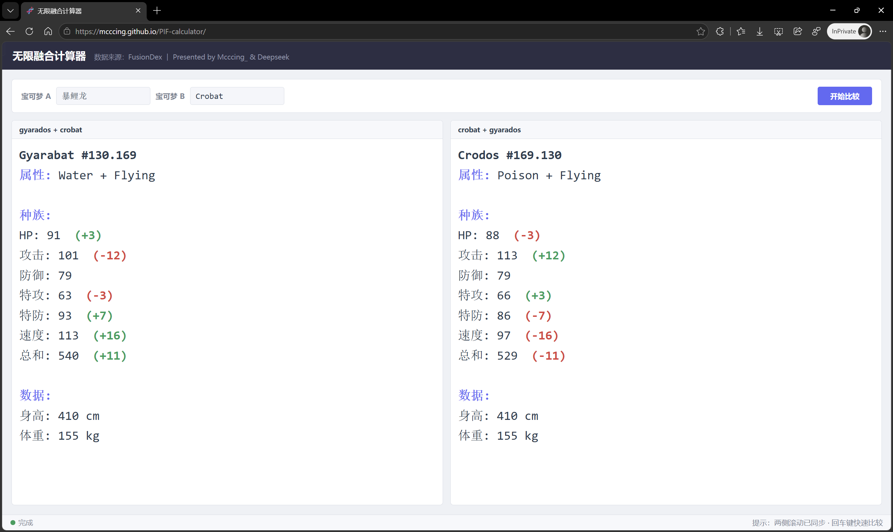

# 🧬 无限融合计算器 (PIF-calculator)

这是一个基于《宝可梦：无限融合》（Pokémon Infinite Fusion）的在线查询与对比工具。现提供网页版和桌面版（EXE），帮助你快速查阅不同宝可梦融合后的种族值与基础数据。

<!-- 在这里插入你的图片 -->

🌐 **在线体验地址**：[https://mcccing.github.io/PIF-calculator/](https://mcccing.github.io/PIF-calculator/)

---

## 🚨 重要提示：网络连接与版本推荐

1. **⚠️ 网页版的网络问题**：
   由于网页版依赖外部数据源，且部分请求通过 Cloudflare Worker 代理（`*.workers.dev`）转发。在**中国大陆网络环境下，该域名可能会被阻断或出现丢包**，导致网页端出现 `signal timed out` 或请求超时。
   *   *解决方案*：使用网页版时，建议开启代理工具以确保连接顺畅。

2. **💻 强烈推荐使用 EXE 桌面版**：
   为了获得最稳定、最快速的体验，**强烈建议下载本地 EXE 版本**。桌面版直接请求目标网站，无需经过第三方代理，**完全没有网络连接问题**，即点即用。
   *   *下载地址*：请前往本仓库的 **[Releases](https://github.com/mcccing/PIF-calculator/releases)** 页面获取最新的 EXE 安装包。

---

## ✨ 核心特性

*   **🇨🇳 完美支持中文输入**：内置完整的官方中文译名字典，无需记忆繁复的英文拼写，直接输入“皮卡丘”、“小磁怪”即可自动转换并查询。
*   **🙈 拒绝贴图剧透**：界面纯文本展示，仅输出宝可梦的**属性、种族值、身高、体重**等核心数据，**不展示融合后的精灵贴图**。把第一次看到惊喜外观的体验留给你自己！
*   **⚖️ 双向对比与差异高亮**：同时展示 `A + B` 与 `B + A` 的融合结果，并用绿色（+）与红色（-）直观对比双方的数据差异。
*   **🤖 100% AI 生成代码**：本项目（包括原本的 Python 桌面版和现在的网页版）的**所有代码均由 AI（DeepSeek）全自动编写完成**，是探索 AI 辅助开发的绝佳实践。

---

## 💻 桌面版 (EXE) 说明

如果你下载了 EXE 版本：
*   无需安装 Python 环境，双击即可运行。
*   数据加载逻辑与网页版一致，但走的是本地网络，不受 CORS 跨域限制。
*   界面采用现代化的 Tkinter 布局，支持回车快捷比较。

---

## 🛠️ 网页版技术实现

*   **技术栈**：纯前端原生 HTML + CSS + JavaScript（无前端框架）。
*   **数据源**：[FusionDex](https://www.fusiondex.org/)。
*   **跨域代理**：因为纯前端无法直接请求第三方网页，项目使用了自建的 Cloudflare Worker 及公共代理（如 corsproxy.io）作为中转，并使用 `DOMParser` 解析返回的 HTML 文本。

---

## ⚠️ 免责声明

1.  **版权归属**：Pokémon（宝可梦）及所有相关名称、图像和数据的版权归 Nintendo / Creatures Inc. / GAME FREAK inc. 以及 FusionDex 所有。
2.  **非商业用途**：本项目仅供个人学习、交流与查询使用，严禁用于任何商业用途。
3.  **数据准确性**：工具内的数据为实时抓取解析，若目标网站结构变更，可能会导致解析失败。

---
*Created with ❤️ & 🤖 by Deepseek.*
